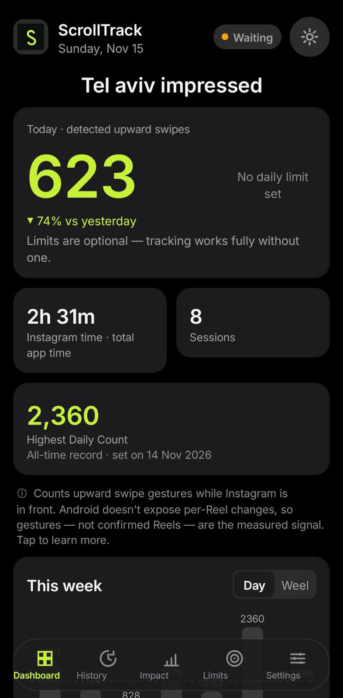
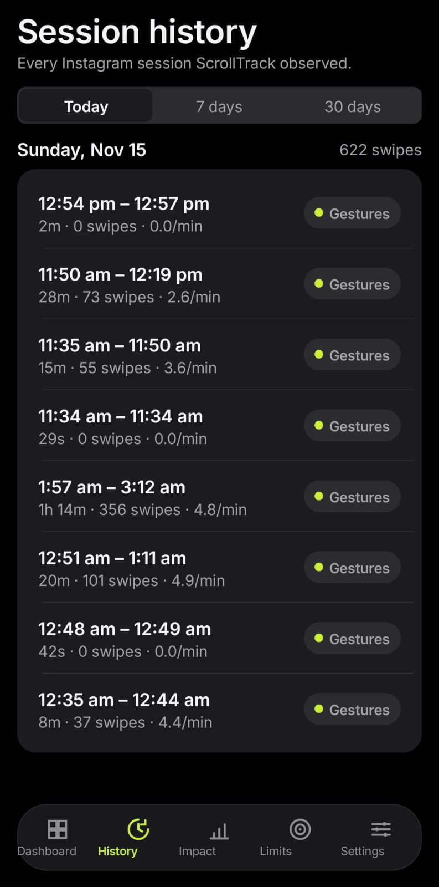
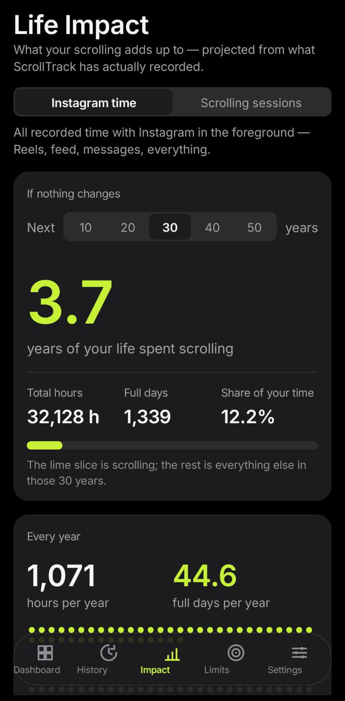
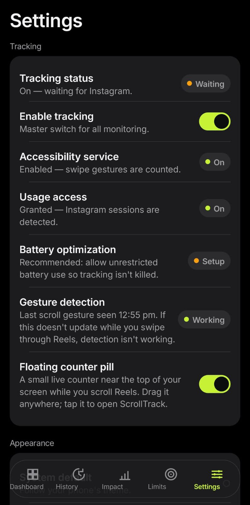

# ScrollTrack

A personal Android tool that makes short-form scrolling visible: it counts how many Instagram Reels you swipe through and how long you spend there, all on your device.

[](https://github.com/daniyal-muzaffar/scrolltrack/releases/latest)
[](LICENSE)


## Screenshots

Real screenshots from a phone running the app:

| Dashboard | History | Life Impact | Settings |
| --- | --- | --- | --- |
|  |  |  |  |

## Features

- Counts Instagram Reels swipes (upward advances to a new Reel) and shows today's total live.
- Measures time two ways: total Instagram time and measured Reels time.
- Dashboard with today's count, a daily title, Day/Week charts, and an all-time Highest Daily Count record.
- History of every day and every session, with per-session Reels time.
- Life Impact: annual impact and lifetime projections — shown only after at least 7 days of recorded data, never estimated from nothing.
- Optional daily target with reminders and quiet hours. All limits are off by default; nothing is ever forced or blocks Instagram.
- Optional floating counter pill while you scroll (off by default).
- CSV export of your history, and a one-tap Clear history.
- In-app updates: the app checks GitHub for new versions and installs them from inside the app.
- Dark theme by default, with light and system options.

## Download and install

Get the APK from the [latest release](https://github.com/daniyal-muzaffar/scrolltrack/releases/latest).

1. Download `ScrollTrack-vX.Y.Z.apk` on your phone.
2. Open it. Android will ask you to allow installing apps from this source — allow it once for your browser or file manager.
3. Open ScrollTrack, finish the short setup, and enable the accessibility service when asked (it is the only way the app can count swipes).

After that, updates arrive in the app itself: when a new version is published, ScrollTrack shows an "Update available" dialog and installs it over the old version, keeping all your data.

## How it works

- An `AccessibilityService` restricted to the Instagram package (`com.instagram.android`) watches for Reels. It detects the Reels surface from the view structure and counts a swipe when the Reels page index advances. When the surface cannot be identified, it falls back to counting upward scroll bursts.
- `UsageStats` is used only to reconcile total Instagram time; the count itself comes from accessibility events.
- Everything is stored locally in SQLite (`sessions` and `day_stats` tables) plus `SharedPreferences`. No account, no ads. Anonymous usage stats are opt-in only — off by default (see Privacy).

## Privacy

- All data stays on your device by default. There is no account, no ads, and no analytics.
- The app uses the network for two things: checking a small version file on GitHub for updates (that request sends nothing about you or your device), and — only if you turn it on in Settings — sending one anonymous stats row a day: a random install ID, the date, and that day's swipe and Instagram-minute totals. No names, no session times, no content. Turning it off stops uploads immediately.
- The accessibility service reads only structural signals — view IDs, scroll indexes, and which app is in the foreground. It never reads text content, usernames, messages, or anything personal, and nothing it sees is stored or sent anywhere.

## Tech stack

- Language: Java (no Kotlin)
- UI: programmatic Android Views — no XML layouts, no Jetpack Compose
- Database: SQLite via `SQLiteOpenHelper` (no Room)
- Min SDK 26 (Android 8.0), target SDK 34 (Android 14)
- Build: a manual `aapt2 → javac → d8 → zipalign → apksigner` pipeline in `build.sh` (no Gradle)
- Tests: JVM unit tests in `tests/` (`run_tests.sh`), plus a Python migration test

## Build from source

Prerequisites: JDK 17 and the Android SDK with build-tools 34.0.0 and platform `android-34`.

```sh
git clone https://github.com/daniyal-muzaffar/scrolltrack.git
cd scrolltrack
cp keystore.properties.example keystore.properties
# edit keystore.properties with your keystore path and passwords
# (or generate one: see the comment inside keystore.properties.example)
./build.sh
```

The APK lands at `out/ScrollTrack.apk`. To run the tests:

```sh
tests/run_tests.sh
```

Signing is configured through `keystore.properties` (git-ignored) or the `KEYSTORE_FILE`, `KEYSTORE_PASSWORD`, `KEY_ALIAS`, and `KEY_PASSWORD` environment variables. Version numbers come from `VERSION_CODE` and `VERSION_NAME` (defaults in `build.sh`).

## Project structure

```
app/src/main/
  AndroidManifest.xml
  java/com/dudeyy/scrolltrack/
    MainActivity.java        # single activity, tab host, update check
    ScrollTrackApp.java      # application entry, installs crash handler
    CrashHandler.java        # writes crashes to a local log file
    data/db/                 # DbHelper, Session, DayStat (SQLite)
    data/prefs/              # Prefs (SharedPreferences)
    data/repo/               # StatsRepository, CsvProvider (export)
    tracking/                # accessibility service, tracking service,
                             # receivers, notifications, overlay pill
    ui/                      # ScreenHost, Theme (design tokens)
    ui/components/           # UiKit, charts, toggles, progress ring
    ui/screens/              # Dashboard, History, LifeImpact, Limits,
                             # Onboarding, Settings
    util/                    # AppUpdater, UpdateCheck, ReelCounter,
                             # ReelsDetection, DayAttribution, SwipeTitles
  res/                       # drawables, fonts (Inter), values, xml
build.sh                     # the build pipeline
tests/                       # JVM unit tests + migration test
```

## Known limitations

- Counting depends on Instagram's UI structure (view IDs and tab labels). If Instagram changes them, detection accuracy can drop — the app falls back to swipe counting and logs what it sees so the rules can be corrected.
- The count is "swipes detected / Reels advanced", not verified Reels watched. Replays do not count; auto-advance does.
- `UsageStats` is throttled or unreliable on some devices, so session times are best-effort on those phones.
- Android only. There is no iOS version.


## Disclaimer

ScrollTrack is a personal project. It is not affiliated with, endorsed by, or connected to Instagram or Meta.

## License and author

MIT — see [LICENSE](LICENSE). By [Daniyal Muzaffar](https://github.com/daniyal-muzaffar).
